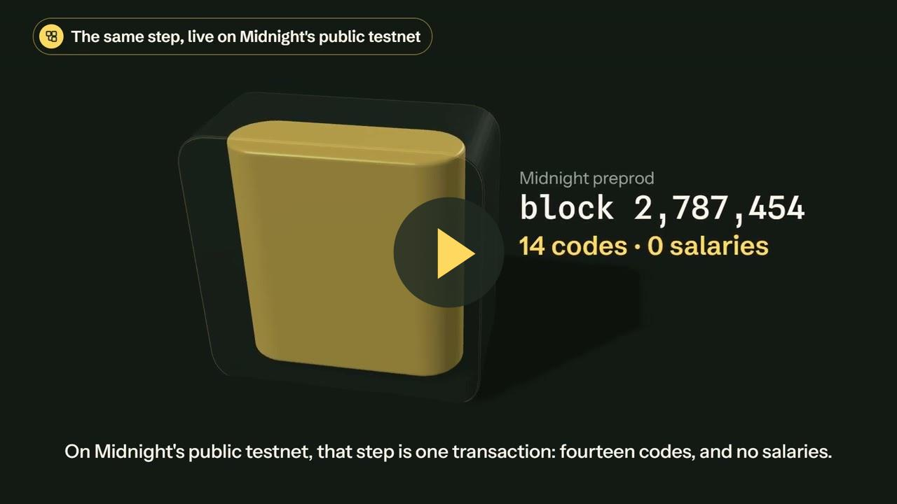

# Equilux

**The first employee-verifiable pay-transparency reporting protocol. Built on Midnight.**

[](https://www.youtube.com/watch?v=AmFv_UKSj4A)

| | |
|---|---|
| **Try it** | [Play the whole story](https://equilux-lac.vercel.app/app) |
| **Verify** | [The Wave 3 report on preprod (32 people, contract v4)](https://equilux-lac.vercel.app/verify?network=preprod&contract=7b4e8bab4075715a90c99c0460f49743b3bd6af5b4fb0ce6314118902051021f) |
| **Research** | [Who would pay (desk research)](docs/who-pays.md) |
| **Deck** | [Wave 2 deck](deck/Equilux-Wave2-deck.pdf) |

Equilux lets a company prove that its legally required gender pay gap report was computed from its
complete, real payroll (every salary the payroll provider's own figure, checked by the works council,
confirmed by the employee it belongs to) while no individual salary is ever revealed to the public,
to colleagues, to the regulator, or to Equilux.

## On Midnight's public testnet (preprod)

**Wave 3, contract v4:** a 32-person sample company, so every batched step runs more than once
(2 batches of 16), with real proofs, run from GitHub Actions through Blockfrost. 58 transactions.

| Step | Blocks | Transactions |
|---|---|---|
| Contract deployed with 6 circuits' keys, then the other 8 added by maintenance transactions | 3,223,740 to 3,223,779 | 9 |
| Payroll provider declares 32 people and commits their rows (`declareRoster`, `addPayrollRows` × 2) | 3,223,785 to 3,223,796 | 3 |
| Works council opens every row (`confirmPayroll` × 2) | 3,223,805 to 3,223,814 | 2 |
| 32 employees enroll, each bound to their own row (`enroll`) | 3,223,819 to 3,224,003 | 32 |
| Pay-gap report: begin, 2 batches, finish | 3,224,009 to 3,224,057 | 4 |
| Variable-pay report: begin, 2 batches, finish | 3,224,063 to 3,224,110 | 4 |
| Job-level report: begin, 2 batches, finish | 3,224,116 to 3,224,162 | 4 |

Contract [`7b4e8bab…2051021f`](https://explorer.preprod.midnight.network/contracts/7b4e8bab4075715a90c99c0460f49743b3bd6af5b4fb0ce6314118902051021f).
Every tx id and hash: [`contract/preprod/deployment-v4.json`](contract/preprod/deployment-v4.json).
[`/verify`](https://equilux-lac.vercel.app/verify?network=preprod&contract=7b4e8bab4075715a90c99c0460f49743b3bd6af5b4fb0ce6314118902051021f)
reads the contract's state from the indexer, decodes it with the compiled contract and shows every
proven figure: mean gap 9.50%, median gap 3.40%, variable-pay mean gap 9.26%, the gap per worker
category, pay quartiles, and a level-adjusted gap of 9.05% over 31 people. No salary is on chain.

**Wave 2, contract v3:** 14 employees, both reports, blocks 2,787,450 to 2,787,556, contract
[`598b346e…d1cb`](https://equilux-lac.vercel.app/verify?network=preprod&contract=598b346e40e5233c605936b9430a80362773b778918b0a899d9bae025257d1cb)
([record](contract/preprod/deployment.json)). `/verify` still decodes it.

## Wave 3: what changed since Wave 2

The Wave 2 review asked how this reaches the Directive's company sizes, who pays, and for less
wallet friction. Wave 3 answers the first two in full; the third is designed and next.

| | Wave 2 (contract v3) | Wave 3 (contract v4) |
|---|---|---|
| People per report | 16, in one transaction | **up to 512**, in batches of 16 (the Directive starts at 150) |
| How a report is proven | one circuit over all records | `begin → batch × ⌈n/16⌉ → finish`, running totals **sealed** between batches |
| Pay quartiles | sorted inside one batch | claimed cut points checked by every batch, so pay order holds across batches |
| Reports | pay gap, variable pay | + **the gap inside equal job levels** (level mix, per-level gap at k = 3, level-adjusted gap) |
| Circuits · tests | 6 · 55 | **14 · 73** (incl. a 250-person company through the compiled circuits) |
| Preprod | 14 people | **32 people, 2 batches, 58 transactions** (table above) |
| Business | none | [desk research on who pays](docs/who-pays.md), labelled as research |

## Why now

The EU Pay Transparency Directive (Directive (EU) 2023/970) makes gender pay gap reporting mandatory.
First reports are due **7 June 2027**, from **2026 pay data**: every year for employers with 250+
employees, every three years for 150 to 249. An *unjustified* gap of **5%** or more within a
**category of workers** forces a joint pay assessment, and Article 7 gives every employee the right to
ask what their category earns, by gender. Yet the report is self-declared: nobody can verify it without
seeing everyone's salary. That is the gap zero-knowledge proofs close.

## How it works

1. **The payroll provider commits the payroll**: it declares the headcount, then commits one hiding hash
   per row, `hash(salary, variable pay, gender, category, job level, payslip nonce)`, 16 rows per
   transaction, before anyone enrolls. Each employee gets their nonce with their payslip.
2. **The works council confirms it**: it opens every committed row against the payroll it is shown,
   16 per transaction, and each row can be opened once. Enrollment is closed until every row is open.
3. **Each employee seals their record and binds it**: the record becomes one commitment and one
   nullifier, and the circuit proves it opens to an unclaimed payroll row. An inflated salary, an
   invented employee or a changed category matches no row and is rejected.
4. **The employer publishes the reports**, each in three stages. `begin` fixes the claimed figures.
   Each `batch` opens the sealed running totals, checks 16 enrolled records not yet counted in this
   report, adds them, and seals the totals again with a fresh salt. `finish` opens the totals and checks
   every claimed figure over the whole company. Only the checked figures are disclosed.
5. **Anyone verifies.** `/verify` reads the proven reports from the chain; each employee proves their
   record was counted with a Merkle-path receipt (`checkReceipt`).

Midnight's dual ledger carries the design: salaries, gender markers, categories, job levels and secrets
exist only as **private-state witnesses**; hashed role keys, the headcount, payroll-row hashes,
commitments, nullifiers, the sealed totals and the proven reports live in **public state**. Every
witness value that reaches the ledger passes an explicit `disclose()` (42 in the contract).

### Why the running totals are sealed

A batched report needs totals carried from one transaction to the next. Public partial sums would leak
far more than the report: after the first batch, the pay of the first 16 people. So the ledger keeps
only `hash(totals, claim, salt)`; each batch proves it knows the totals behind the current seal, and
writes the next one.

### What the report circuits prove

- **Completeness and integrity**: the report counts exactly the committed payroll rows, every record
  enrolled and bound to a row, each counted once (a `counted` set of `hash(report, kind, commitment)`).
- **Mean gaps**: verified without division, `g·base ≤ diff·10000 < (g+1)·base`.
- **Median gaps**: by rank counting against the claimed medians, batch by batch (fewer than half
  strictly below, at least half at or below). No sort in-circuit.
- **Per worker category**: mean pay per gender and the gap, published only when both groups have at
  least 3 people (k = 3); otherwise headcounts only. Gaps of 5% or more are flagged.
- **Variable pay and quartiles**: the variable-pay mean and median gap, the share of each gender
  receiving variable pay, and the gender mix of each pay quartile: every record in quartile *b* lies
  between the claimed cut points, and each quartile holds a quarter of the company.
- **Inside equal job levels**: each level's women/men mix (always), each level's gap when both groups
  have at least 3 people, and the headcount-weighted level-adjusted gap. A small gap inside levels does
  not prove the levels are fair, since who reaches which level matters too; that stays a human judgement.

Every figure is supplied as a claim and **checked**, never trusted. A claim one basis point off is
rejected.

## Try it

**On the live site, no install:** https://equilux-lac.vercel.app/app, then **Play the whole story**.
The page runs the compiled contract (`contract/build/contract/index.js`) on Midnight's WebAssembly
runtime: the same circuits, hashes, Merkle tree and assertions as on-chain, without proof generation.
Press **Try to cheat** and pick any of the 11 tricks: each is refused with the contract's own message.
For the Directive's size: **Use your own payroll → 250-person company → Play the whole story** (three
batched reports in about 30 seconds). Or upload a Personio or DATEV CSV export; it is read in the page.

**With your own wallet on preprod:** **Connect wallet** in the header (Lace or 1AM, network set to
Preprod, tNIGHT designated for DUST). Each step is then proven and submitted from your wallet; the
deploy takes 9 approvals (the contract plus 8 circuits' keys, see below). Proving keys are served from
GitHub Pages ([`.github/workflows/keys.yml`](.github/workflows/keys.yml)).

**Check the on-chain reports:** [`/verify`](https://equilux-lac.vercel.app/verify?network=preprod&contract=7b4e8bab4075715a90c99c0460f49743b3bd6af5b4fb0ce6314118902051021f).
Midnight's own preprod indexer and RPC were closed in October 2026; the site reads through Blockfrost via
a small server-side proxy ([`webapp/api/indexer.js`](webapp/api/indexer.js)) that only forwards queries.

**The preprod run:** [`.github/workflows/preprod-v4.yml`](.github/workflows/preprod-v4.yml), mode `probe`
(15 minutes) then `run`. It needs the repository secrets `PREPROD_SEED` and `BLOCKFROST_PROJECT_ID`, and
it resumes after any interruption: wallet state and every landed transaction are cached.

**With real proofs on a local Midnight network:**

```bash
cd contract
pnpm install
pnpm network:up      # Midnight node + indexer + proof server (Docker)
pnpm app:server      # API on http://127.0.0.1:8787
```

Then `cd webapp && pnpm install && pnpm dev` and open http://localhost:5173/app. The same flow runs as one
script with `pnpm demo:standalone`. These two were run end to end on v3 in Wave 2; on v4 they are
type-checked but not yet run, and they still deploy all keys in one transaction, which a local node
with preprod's limits would also refuse; the split deploy described below is the fix to port.

**Tests:** `cd contract && pnpm test`: 73 tests on the compiled circuits and the claim arithmetic
(roster and council batches, binding, roles, receipts, every statistic across batches, a 250-person
company, every rejection) and on the CSV importer.

### Deploying a contract bigger than a block

A deploy writes the whole contract state, verifier keys included (about 2.5 KB per circuit), and a
preprod block accepts 50,000 written bytes. With all 14 keys the v4 deploy wrote about 38,900 bytes and
the node refused it. So the deploy carries the keys that fit in 20,000 bytes (6 of 14, the size of the
Wave 2 deploy that landed) and the remaining 8 are added one per maintenance transaction, signed with the
contract's maintenance key. Both the GitHub run and the wallet path do this, and both resume where they
stopped.

## Scope and threat model

A compliance tool that overstates itself is worse than none, so the boundary is explicit.

- *Salaries hidden from HR:* no. The employer already holds payroll. Equilux hides salaries from the
  public, colleagues, the regulator and us; the employer can no longer vouch for its own data.
- *An honest payroll by itself:* the provider commits the rows and the works council checks them; a
  provider, employer and council colluding could still commit false rows. Each employee enrolls against
  their own row, so a wrong salary is visible to the person it belongs to.
- *Who holds a payslip nonce:* whoever holds it can claim that row once; the figure is still
  payroll's, and the real employee then cannot enroll and sees it immediately.
- *Judging what is justified:* the circuits prove gaps and flag those at 5% or more. Whether a gap is
  justified by objective, gender-neutral criteria, and whether the job levels themselves are fair, is a
  human judgement.
- *Scale:* up to 512 people per contract instance (a compile-time size). Tested at 250 in the compiled
  circuits and in the browser; run on preprod at 32. We do not claim 250 on-chain.
- *Wallet friction:* each employee confirms with a wallet today. A walletless link with fees paid by
  the employer is designed, not built.
- *Gender beyond the Directive's annex:* binary reporting markers, as the annex is written today.

## Integration surface (the plugin)

Equilux sits next to the HRIS rather than replacing it. The API a payroll-provider plugin calls:

| Endpoint | Party | Circuits |
|---|---|---|
| `POST /api/import/csv` `{csv}` | provider | none (parses Personio / DATEV exports, incl. a job-level column) |
| `POST /api/deploy` | employer | constructor (employer, provider and council keys) |
| `POST /api/roster` `{rows}` | provider | `declareRoster`, `addPayrollRows` × ⌈n/16⌉ |
| `POST /api/confirm` `{openings}` | works council | `confirmPayroll` × ⌈n/16⌉ |
| `POST /api/enroll` `{salary, variable, gender, category, level, secret, rowNonce}` | employee | `enroll` |
| `POST /api/publish` `{payroll}` | employer | `beginReport`, `reportBatch` × ⌈n/16⌉, `finishReport` |
| `POST /api/publish-variable` `{payroll}` | employer | `beginVariableReport`, `variableBatch` × ⌈n/16⌉, `finishVariableReport` |
| `POST /api/publish-levels` `{payroll}` | employer | `beginLevelReport`, `levelBatch` × ⌈n/16⌉, `finishLevelReport` |
| `POST /api/receipt` `{commitment}` | employee | `checkReceipt` |
| `GET /api/ledger`, `/api/status`, `/api/jobs/:id` | anyone | reads from the indexer |

Writes return `202 {jobId}`. A whole phase (every batch of a report) is first executed locally against
the live on-chain state, so a claim that would only fail at `finish` is refused before any fee is paid.
In production each party runs its own prover with only its own secret.

## Repository layout

- `contract/src/equilux.compact`: the contract, 14 circuits. Compiled with `compact compile +0.30.0`.
- `contract/deploy/`: claim and batch arithmetic (`claims.ts`), the steps of each phase
  (`witnesses.ts`), CSV import (`payroll-csv.ts`), the API (`server.ts`), the scripted run
  (`standalone-demo.ts`).
- `contract/preprod/`: the preprod scripts (`run-v4.ts`) and their records (`deployment-v4.json`,
  Wave 2's `deployment.json`).
- `contract/test/`: `circuits.test.ts` drives the compiler-generated contract; `payroll-csv.test.ts`.
- `webapp/`: the product. `src/lib/browser-contract.ts` runs the compiled contract in the page;
  `src/lib/wallet-chain.ts` drives preprod through a visitor's wallet; `src/VerifyPage.tsx` is `/verify`
  (v4 and v3 contracts); `api/indexer.js` is the read-only indexer proxy.
- `docs/who-pays.md`: desk research on the market and who pays. `deck/`: pitch decks. `brand/`: logo.

## Roadmap

- **Wave 1 (delivered):** contract with private-state management, proven end to end on a local network.
- **Wave 2 (delivered):** payroll provider and works council, all seven Article 9 indicators, the full
  flow on preprod, `/verify` and the filing pack, Connect wallet, CSV import, the guided app.
- **Wave 3 (this wave):** contract v4, batched to 512 people with sealed running totals; the gap inside
  equal job levels; a 32-person run on preprod; desk research on who pays.
- **Next:** walletless employee confirmation; three validation conversations (an HR lead at a 250+
  employer, a works council member, a payroll provider); a Personio sandbox plugin; 250 people on preprod.

## Brand

The mark is the **Equals Seal**: an equals sign where only one side is shown. The solid bar is the
published aggregate, the hollow bar the sealed payroll it was proven from. **Equilux** is the day
night and day are exactly equal.

## License

Midnight-related code developed for the Buildathon is released under the **Apache License 2.0**.
