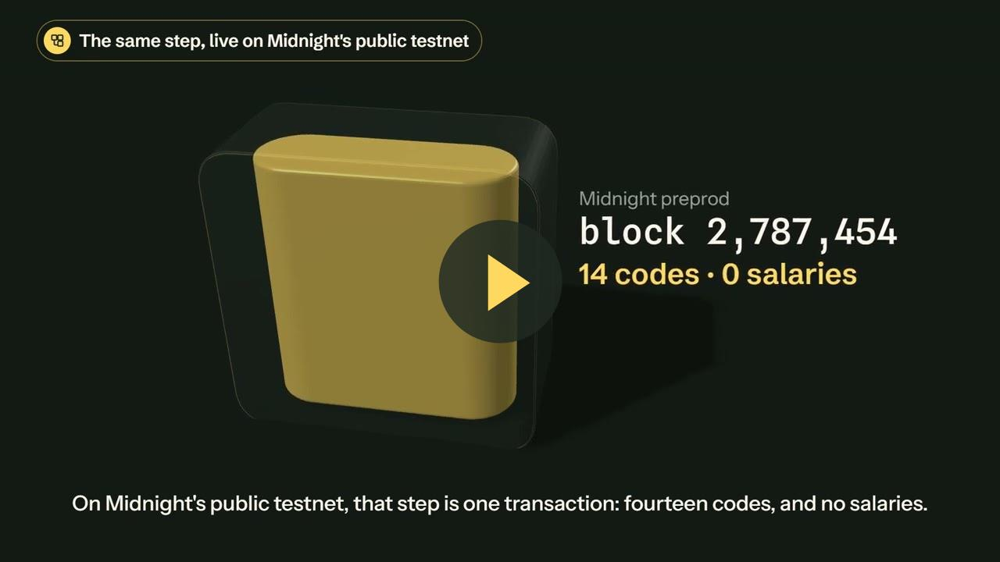

# Equilux

**The first employee-verifiable pay-transparency reporting protocol. Built on Midnight.**

[](https://www.youtube.com/watch?v=AmFv_UKSj4A)

| | |
|---|---|
| **Try it** | [Play the whole story](https://equilux-lac.vercel.app/app) |
| **Verify** | [The 14-person report on preprod](https://equilux-lac.vercel.app/verify?network=preprod&contract=598b346e40e5233c605936b9430a80362773b778918b0a899d9bae025257d1cb) |
| **Deck** | [Wave 2 deck](deck/Equilux-Wave2-deck.pdf) |

Equilux lets a company prove that its legally required gender pay gap report was computed from its
complete, real payroll (every salary the payroll provider's own figure, checked by the works council,
confirmed by the employee it belongs to) while no individual salary is ever revealed to the public,
to colleagues, to the regulator, or to Equilux.

## On Midnight's public testnet (preprod)

The full flow runs on preprod: 14 employees, three role keys, both reports proven and finalized.

| Step | Block | Explorer |
|---|---|---|
| Contract deployed | 2,787,450 | [contract 598b346e…d1cb](https://preprod.midnightexplorer.com/contracts/598b346e40e5233c605936b9430a80362773b778918b0a899d9bae025257d1cb) |
| Payroll provider commits 14 payroll rows (`declareRoster`) | 2,787,454 | |
| Works council approves (`confirmPayroll`) | 2,787,463 | |
| 14 employees enroll, each bound to their own row (`enroll`) | 2,787,468 to 2,787,529 | |
| Pay-gap report proven (`publishReport`) | 2,787,543 | |
| Variable-pay report proven (`publishVariablePay`) | 2,787,556 | |

The record is in [`contract/preprod/deployment.json`](contract/preprod/deployment.json) (every tx id and
hash). [`/verify`](https://equilux-lac.vercel.app/verify?network=preprod&contract=598b346e40e5233c605936b9430a80362773b778918b0a899d9bae025257d1cb)
reads the contract's state straight from the indexer, decodes it with the compiled contract and shows
every proven figure: mean gap 9.69%, median gap 1.81%, Engineering 13.88% (flagged), Sales 3.70%,
Operations suppressed (too few people), variable-pay mean gap 27.50%, and the pay quartiles.

## Wave 2: what changed since Wave 1

Wave 1 received a grant. The judge asked for two things: **payroll-provider attestation**, and **a
plugin for Workday / Personio rather than a standalone app**. Wave 2 builds both, then goes further.

| | Wave 1 | Wave 2 |
|---|---|---|
| Who vouches for each salary | the employer, for its own data | **the payroll provider** commits a hiding hash of every payroll row (own key); an employee can only enroll a record that opens to their row |
| Third-party check | none | **the works council** (own key) opens every committed row against the real payroll before anyone enrolls (`confirmPayroll`) |
| Leaving someone out · inventing someone · changing pay | blocked only if they had enrolled | **all blocked**: the report must cover exactly the committed rows |
| Figures proven | the company-wide mean gap | **all seven Article 9 indicators**: mean and median gap, gap per worker category (k = 3), variable-pay mean and median gap, share receiving variable pay, pay quartiles |
| Circuits · tests on the compiled circuits | 4 · 9 | **6 · 45** (55 tests in total) |
| Network | a local Midnight network | **Midnight's public testnet (preprod)**, full flow, table above |
| Hosted site | a TypeScript replica of the rules | **the real compiled contract running in the browser** (Midnight's WebAssembly runtime) |
| HRIS | none | **Personio / DATEV CSV import**, read in the browser, plus a documented API for a payroll plugin |
| Anyone can check | no | **`/verify`**: reads the report from the chain; **filing pack** (a JSON report file) checked figure by figure against the chain |
| Wallet | none | **Connect wallet**: any Midnight DApp-connector wallet (Lace, 1AM); each step is proven and submitted from the visitor's own wallet on preprod, with fee (DUST) checks before every write |
| The app | four tabs of forms | a **guided six-chapter story** anyone can follow, and **11 cheats** a visitor can try, each refused in the contract's own words |

## Why now

The EU Pay Transparency Directive (Directive (EU) 2023/970) makes gender pay gap reporting mandatory.
First reports are due **7 June 2027**, from **2026 pay data**, for every EU employer with 250+
employees. An *unjustified* gap of **5%** or more within a **category of workers** forces a joint pay
assessment, and Article 7 gives every employee the right to ask what their category earns, by gender.
Yet the report is self-declared: nobody can verify it without seeing everyone's salary. That is the
gap zero-knowledge proofs close.

## How it works

1. **The payroll provider commits the payroll**: one hiding hash per row,
   `hash(salary, variable pay, gender, category, payslip nonce)`, in one transaction, before anyone
   enrolls. Each employee gets their nonce with their payslip.
2. **The works council confirms it**: it opens every committed row against the payroll it is shown
   and approves (`confirmPayroll`). Enrollment is closed until it does.
3. **Each employee seals their record and binds it**: the record becomes one commitment and one
   nullifier, and the circuit proves it opens to an unclaimed payroll row. An inflated salary, an
   invented employee or a changed category matches no row and is rejected.
4. **The employer publishes the reports.** `publishReport` and `publishVariablePay` verify, over the
   complete bound set, every figure they disclose, and disclose nothing else.
5. **Anyone verifies.** `/verify` reads the proven report from the chain; each employee proves their
   record was counted with a Merkle-path receipt (`checkReceipt`).

Midnight's dual ledger carries the design: salaries, gender markers, categories and secrets exist only
as **private-state witnesses**; hashed role keys, the headcount, payroll-row hashes, commitments,
nullifiers and the proven reports live in **public state**. Every witness value that reaches the ledger
passes an explicit `disclose()`.

### What the report circuits prove

- **Completeness and integrity**: the witness covers exactly the committed payroll rows, each record
  enrolled (nullifier present) and bound to a payroll row, pairwise distinct.
- **Mean gaps**: verified without division, `g·base ≤ diff·10000 < (g+1)·base`.
- **Median gaps**: the lower median per gender by rank counting (fewer than half strictly below, at
  least half at or below). No sort in-circuit.
- **Per worker category**: mean pay per gender and the gap, published only when both groups have at
  least 3 people (k = 3); otherwise headcounts only. Gaps of 5% or more are flagged.
- **Variable pay and quartiles**: the variable-pay mean and median gap, the share of each gender
  receiving variable pay, and the gender mix of each pay quartile.

Every figure is supplied as a claim and **checked**, never trusted. A claim one basis point off is
rejected.

## Try it

**On the live site, no install:** https://equilux-lac.vercel.app/app, then **Play the whole story**.
The page runs the compiled contract (`contract/build/contract/index.js`) on Midnight's WebAssembly
runtime: the same circuits, hashes, Merkle tree and assertions as on-chain, without proof generation.
Then press **Try to cheat** and pick any of the 11 tricks: each is refused with the contract's own
message. Use your own payroll: **Use your own payroll → Upload a CSV** (Personio or DATEV export).

**With your own wallet on preprod:** **Connect wallet** in the header (Lace or 1AM, network set to
Preprod, tNIGHT designated for DUST). Each step is then proven and submitted from your wallet.
Proving keys are served from GitHub Pages ([`.github/workflows/keys.yml`](.github/workflows/keys.yml)).

**Check the on-chain report:** [`/verify`](https://equilux-lac.vercel.app/verify?network=preprod&contract=598b346e40e5233c605936b9430a80362773b778918b0a899d9bae025257d1cb).
Midnight's own preprod indexer was decommissioned on 2026-10-09; the site reads through Blockfrost via
a small server-side proxy ([`webapp/api/indexer.js`](webapp/api/indexer.js)) that only forwards queries.

**With real proofs on a local Midnight network:**

```bash
cd contract
pnpm install
pnpm network:up      # Midnight node + indexer + proof server (Docker)
pnpm app:server      # API on http://127.0.0.1:8787
```

Then `cd webapp && pnpm install && pnpm dev` and open http://localhost:5173/app: each action is proven
by the proof server and finalized on the node. The same flow runs as one script with `pnpm demo:standalone`.
The preprod run itself is [`.github/workflows/preprod.yml`](.github/workflows/preprod.yml).

**Tests:** `cd contract && pnpm test`: 55 tests, 45 on the compiled circuits (roster, council,
binding, roles, receipts, every statistic, every rejection) and 10 on the CSV importer and claim arithmetic.

## Scope and threat model

A compliance tool that overstates itself is worse than none, so the boundary is explicit.

- *Salaries hidden from HR:* no. The employer already holds payroll. Equilux hides salaries from the
  public, colleagues, the regulator and us; the employer can no longer vouch for its own data.
- *An honest payroll by itself:* the provider commits the rows and the works council checks them; a
  provider, employer and council colluding could still commit false rows. Each employee enrolls against
  their own row, so a wrong salary is visible to the person it belongs to.
- *Who holds a payslip nonce:* whoever holds it can claim that row once; the figure is still
  payroll's, and the real employee then cannot enroll and sees it immediately.
- *Judging what is justified:* the circuits prove gaps and flag those at 5% or more. Whether a gap is
  justified by objective, gender-neutral criteria is a human judgement.
- *Production scale:* a sized instance, 16 records per report and 4 categories, set at compile time.
- *Gender beyond the Directive's annex:* binary reporting markers, as the annex is written today.
- *Wallet writes:* connecting Lace is verified; a full write from a visitor's wallet needs DUST in that
  wallet. The preprod deployment above was run by our own wallet from GitHub Actions.

## Integration surface (the plugin)

Equilux sits next to the HRIS rather than replacing it. The API a payroll-provider plugin calls:

| Endpoint | Party | Circuit |
|---|---|---|
| `POST /api/import/csv` `{csv}` | provider | none (parses Personio / DATEV exports) |
| `POST /api/deploy` | employer | constructor (employer, provider and council keys) |
| `POST /api/roster` `{rows}` | provider | `declareRoster` |
| `POST /api/confirm` `{openings}` | works council | `confirmPayroll` |
| `POST /api/enroll` `{salary, variable, gender, category, secret, rowNonce}` | employee | `enroll` |
| `POST /api/publish` `{payroll}` | employer | `publishReport` |
| `POST /api/publish-variable` `{payroll}` | employer | `publishVariablePay` |
| `POST /api/receipt` `{commitment}` | employee | `checkReceipt` |
| `GET /api/ledger`, `/api/status`, `/api/jobs/:id` | anyone | reads from the indexer |

Writes return `202 {jobId}`. Every circuit is first executed locally against the live on-chain state,
so a rejected witness returns the circuit's assertion in milliseconds and never enters the proving
pipeline. In production each party runs its own prover with only its own secret.

## Repository layout

- `contract/src/equilux.compact`: the contract, 6 circuits (`declareRoster`, `confirmPayroll`,
  `enroll`, `checkReceipt`, `publishReport`, `publishVariablePay`). Compiled with `compact compile +0.30.0`.
- `contract/deploy/`: claim arithmetic (`claims.ts`), CSV import (`payroll-csv.ts`), the API
  (`server.ts`), the scripted run (`standalone-demo.ts`).
- `contract/preprod/`: the preprod deployment script and its record (`deployment.json`).
- `contract/test/`: `circuits.test.ts` drives the compiler-generated contract; `payroll-csv.test.ts`.
- `webapp/`: the product. `src/lib/browser-contract.ts` runs the compiled contract in the page;
  `src/lib/wallet-chain.ts` drives preprod through a visitor's wallet; `src/VerifyPage.tsx` is `/verify`;
  `api/indexer.js` is the read-only indexer proxy.
- `deck/`: pitch deck. `brand/`: logo artboards.

## Roadmap

- **Wave 1 (delivered):** contract with private-state management, proven end to end on a local network.
- **Wave 2 (this wave):** payroll provider and works council, all seven Article 9 indicators, the full
  flow on preprod, `/verify` and the filing pack, Connect wallet, CSV import, the guided app.
- **Wave 3:** a first full write from a visitor's wallet on video; a payroll-provider plugin against a
  real Personio sandbox; larger instances (per employer band); one named pilot with a works council.

## Brand

The mark is the **Equals Seal**: an equals sign where only one side is shown. The solid bar is the
published aggregate, the hollow bar the sealed payroll it was proven from. **Equilux** is the day
night and day are exactly equal.

## License

Midnight-related code developed for the Buildathon is released under the **Apache License 2.0**.
